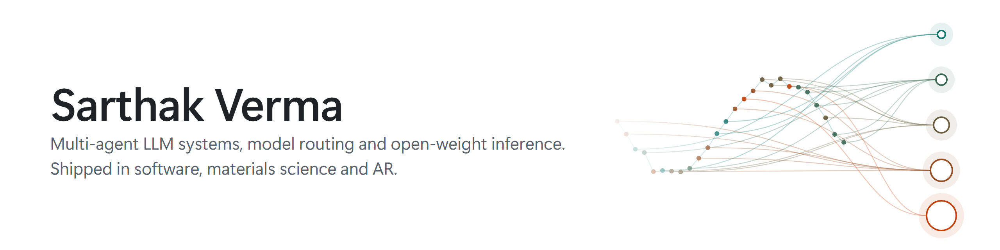
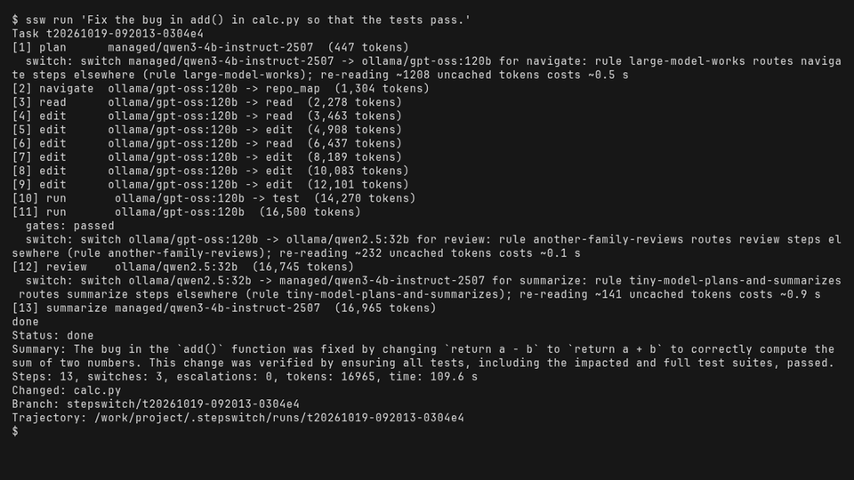

<picture>
  <source media="(prefers-color-scheme: dark)" srcset="assets/header-dark.png">
  
</picture>

<samp>
<a href="https://www.linkedin.com/in/sarthak-verma-56b7061b9">linkedin</a> &nbsp;|&nbsp;
<a href="https://x.com/SarthakVeri1g2">x</a> &nbsp;|&nbsp;
<a href="https://devpost.com/vsarthak05">devpost</a> &nbsp;|&nbsp;
<a href="https://doi.org/10.1038/s42004-025-01800-y">paper</a>
</samp>

I build multi-agent LLM systems and the layer underneath them: orchestration, model routing, tool calling and inference on open-weight models. My main project, Stepswitch, sends each step of a coding task to the model that suits it, from small local models to large open-weight and hosted ones, and keeps a change only if your tests pass.

I don't stay in one field. So far I've built for software, materials science and augmented reality, and each project checks its output against something real: your tests, measured data, or the geometry of diffraction.

## Projects

<table>
<tr>
<td width="50%" valign="top">

<b><a href="https://github.com/sarthak-1111/stepswitch">Stepswitch</a></b> 
A multi-agent orchestrator for coding. Each step of a task goes to the model and harness that suit it, across local open-weight models and hosted APIs. Changes must pass your tests, and every claim in the README re-runs with <code>ssw prove</code>.

</td>
<td width="50%" valign="top">

<b><a href="https://github.com/sarthak-1111/concord">Concord</a></b> 
Multi-agent analysis for materials science. AI agents read XRD, PDF and XAFS data from one sample and cross-check each other into one structural model. Tested on published measured data, not only simulations.

</td>
</tr>
<tr>
<td width="50%" valign="top">

</td>
<td width="50%" valign="top">

<b><a href="https://github.com/sarthak-1111/braggs-room">Bragg's Room</a></b> 
Built for Learn AR with SPECS

X-ray diffraction at room scale. Turn a crystal on your desk and watch diffraction spots light up on your wall at their true angles, then work out whether a mystery crystal is simple cubic or face-centred cubic from which spots appear.

<a href="https://youtu.be/9aPGQw05psg">Watch the video</a>

</td>
</tr>
</table>

## Publication

**Machine Learning-Guided Multimodal Synchrotron Analysis Workflow for Fuel Cell Electrocatalyst Discovery** 
*Communications Chemistry*, 2025

From my day job as a research scientist in Japan: eight synchrotron measurements of 46 platinum catalysts combined into one model that predicts catalyst activity. I co-led the modelling.
