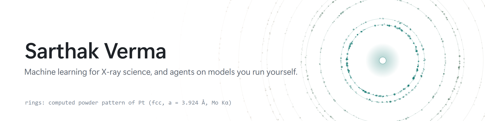
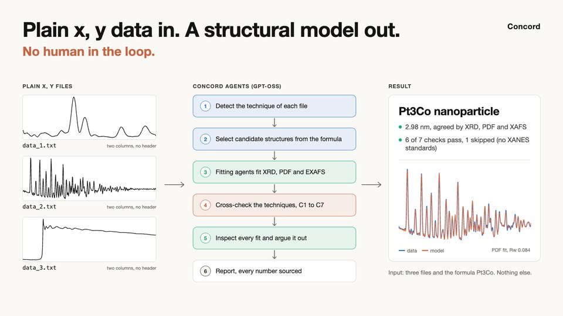
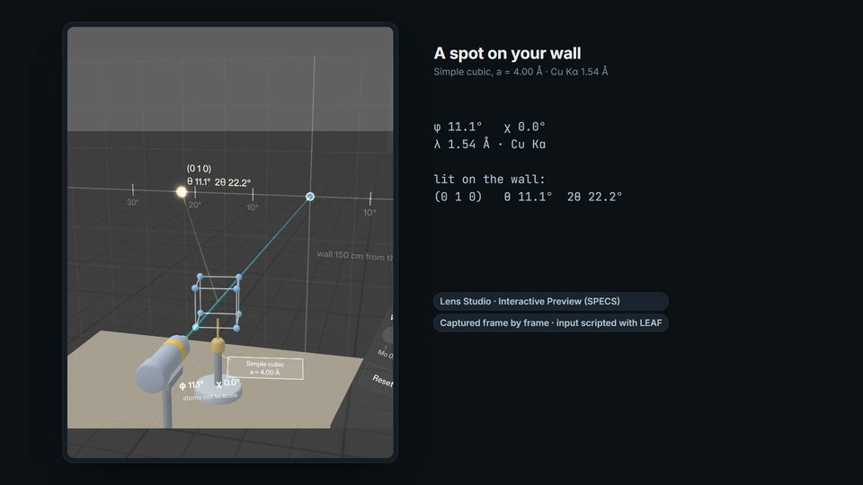

<picture>
  <source media="(prefers-color-scheme: dark)" srcset="assets/banner-dark.png">
  
</picture>

<samp>
<a href="https://www.linkedin.com/in/sarthak-verma-56b7061b9">linkedin</a> &nbsp;|&nbsp;
<a href="https://x.com/SarthakVeri1g2">x</a> &nbsp;|&nbsp;
<a href="https://devpost.com/vsarthak05">devpost</a> &nbsp;|&nbsp;
<a href="https://doi.org/10.1038/s42004-025-01800-y">paper</a>
</samp>

I'm a research scientist in Japan working on machine learning for X-ray, synchrotron and spectroscopy data. I also build open-source tools for LLM agents that run on your own hardware, and I treat them like experiments: if a README states a number, there should be a command that reproduces it.

## Research

**Machine Learning-Guided Multimodal Synchrotron Analysis Workflow for Fuel Cell Electrocatalyst Discovery** 
*Communications Chemistry*, 2025

We combined eight synchrotron measurements of 46 platinum-based catalysts into one set of descriptors and trained models to predict each catalyst's mass activity. I co-led the machine learning side.

## Projects

<table>
<tr>
<td width="50%" valign="top">

<b><a href="https://github.com/sarthak-1111/stepswitch">Stepswitch</a></b> 
An orchestrator for coding agents on local and remote models. Each step of a task goes to the model that suits it, every change has to pass your tests, and every claim in the README re-runs with <code>ssw prove</code>.

</td>
<td width="50%" valign="top">

<b><a href="https://github.com/sarthak-1111/concord">Concord</a></b> 
XRD, PDF and XAFS data from one sample, analysed together by AI agents and cross-checked into one structural model. Tested on published measured data, not only simulations.

</td>
</tr>
<tr>
<td width="50%" valign="top">

</td>
<td width="50%" valign="top">

<b><a href="https://github.com/sarthak-1111/braggs-room">Bragg's Room</a></b> 
Built for Learn AR with SPECS

X-ray diffraction at room scale. Turn a crystal on your desk and watch diffraction spots light up on your wall at their true angles, then work out whether a mystery crystal is simple cubic or face-centred cubic from which spots appear.

<a href="https://youtu.be/9aPGQw05psg">Watch the video</a>

</td>
</tr>
</table>
